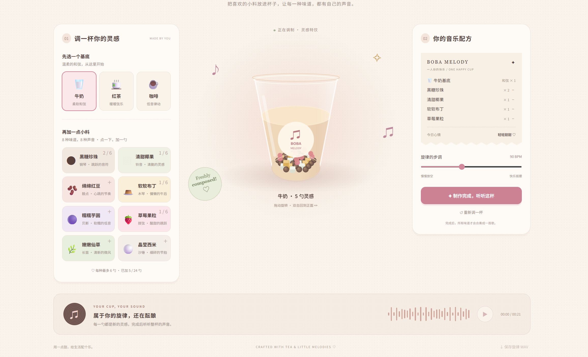

# Boba Melody · 啵啵音乐铺

**Assignment 3: An interactive experience**

Boba Melody is a playful browser experience that turns making milk tea into making music. It is intended for people who enjoy casual creative activities, including people with no music training. Instead of choosing instruments in a music editor, visitors choose a drink base and toppings, hear short previews, and finish their drink to hear the ingredients play together.

The aim is to make the connection between a choice and its sound easy to explore: add something, notice the change, then keep it, remove it, or try a different combination.

## Preview

**[▶ Try Boba Melody — Live Website](https://qiugeapple.github.io/assignment3-sound-dj/)**

Open the link, choose a base and toppings, then finish your drink to hear the full composition. Click an ingredient to enable audio and make sure your device volume is on.



A short screen recording with computer audio can also demonstrate the preview-to-composition interaction; do not record another person.

## How to play

Use the **中文 / English** button in the header to switch languages. The first visit defaults to English; the selected language is remembered on the same browser when local storage is available. Switching languages preserves the current recipe, tempo and playback state. Ingredient names, recipe details, status messages, audio-help controls and accessibility labels are translated.

1. Choose **牛奶 (milk)**, **红茶 (black tea)**, or **咖啡 (coffee)** as the musical base. Each provides a different chord foundation and sound character.
2. Click a topping to add one spoonful and hear a short instrument-style preview. The cup and recipe receipt update immediately.
3. Compare combinations. Use the minus buttons on the receipt to remove ingredients, or adjust the tempo between **70 and 120 BPM**.
4. Click **制作完成，听听这杯** to hear the complete eight-bar composition. Full playback becomes available only after choosing a base and at least one topping.
5. Stop or replay the composition, save it as a WAV file, or select **重新调一杯** to reset.

| Topping | Musical role |
| --- | --- |
| Black sugar pearls / 黑糖珍珠 | Piano-style melody |
| Coconut jelly / 清甜椰果 | Bell tones |
| Red beans / 绵绵红豆 | Drum rhythm |
| Pudding / 软软布丁 | Xylophone-style notes |
| Taro balls / 糯糯芋圆 | Bass |
| Strawberry pieces / 草莓果粒 | Plucked-string-style notes |
| Grass jelly / 嫩嫩仙草 | Flute-style melody |
| Sago / 晶莹西米 | Shaker rhythm |

Each topping allows **up to six spoonfuls**, with **24 spoonfuls in total**. Quantity changes the visual amount and modestly changes the instrument's level in the mix. It does not create a new melody for every spoonful. Topping types determine which musical parts are included.

Drag the cup horizontally to rotate it; double-click to return to the front. Rotation supports the visual metaphor, while making and revising a musical recipe is the main interaction.

## Input, response and feedback

| Input | Program response | Feedback |
| --- | --- | --- |
| Select a base | Change the chord foundation | Highlight the choice, preview its sound, and update the cup and receipt |
| Add or remove a topping | Change its count and musical contribution | Show the ingredients and quantity; adding also plays a brief preview |
| Finish the drink | Schedule the selected musical parts together | Show playback status, elapsed time and an animated player; enable replay and export |
| Edit a finished recipe or its tempo | Stop the old composition and invalidate the finished state | Require finishing again so playback matches the revised recipe |

## Run locally

This is a static **HTML, CSS and JavaScript** project. It requires no package installation, build step, backend, API key, paid account, microphone or model download.

### VS Code with Live Server

1. Download or clone the repository and open its folder in VS Code.
2. Install **Live Server** by **Ritwick Dey**, if needed.
3. Right-click `index.html` and select **Open with Live Server**.
4. Open the local URL shown by the extension. Keep `index.html`, `style.css`, `app.js` and `i18n.js` in the same directory.
5. Click **开启声音 / 测试音** to request audio and send three short test notes, then choose a base or topping. Check media volume and the page's sound toggle. An engine-started message does not prove that the phone speaker is audible.
6. If live sound is still silent, finish a valid recipe and click **听不到？生成兼容音频**. Once preparation finishes, click **播放兼容音频**. This second deliberate tap plays a locally generated WAV through a normal browser audio element. Editing the recipe discards the old audio.

Alternatively, open `index.html` directly in a current desktop browser. A local server is recommended for development.

The code uses browser-native **Canvas 2D**, **Web Audio API** and **OfflineAudioContext**. The cup uses projected three-dimensional coordinates and depth-sorted ingredients rather than an imported model or external 3D library.


## Mistakes and interruptions

- **Incomplete recipe:** finishing and full playback remain disabled until a base and at least one topping are present.
- **Repeated clicks:** each accepted click adds one spoonful. At six of one type or 24 in total, further additions are rejected with a message. The receipt's minus buttons allow corrections.
- **Editing during playback:** changing ingredients or tempo stops the old composition. Finish the revised drink to hear it again.
- **Audio or export failure:** the interface displays a retry message. WAV export requires `OfflineAudioContext` support.
- **Font service unavailable:** the page falls back to a system font. Its music and interaction do not require the external font request.

## Known limitations

- Instrument sounds are synthesized approximations, not recordings. Musical patterns are predefined; this is not an AI music generator.
- Compositions last approximately 16–27 seconds depending on tempo. Recipes select and mix musical parts rather than generating a new song structure each time.
- Refreshing clears the recipe; there is no persistent storage.
- The waveform animation indicates playback but is not a measured audio spectrum.
- The interface supports English and Chinese. Full keyboard and screen-reader access to canvas rotation has not been implemented.
- Core functions were checked in the Codex in-app browser. Cross-browser and physical-device coverage is limited; universal compatibility is not claimed.
- The author reports no sound on an iPhone 17 and a classmate's vivo phone (exact vivo model and both browser versions are not recorded). Audio startup recovery, a test-tone control and a WAV-based compatible playback option have since been added. Desktop checks pass, but a successful retest on those two phones is still required; full mobile compatibility is not claimed.

For optional developer regression checks, with Node.js installed run `node --test --test-isolation=none audio-startup.test.cjs`. Node.js is not needed to use the website.

## Files

```text
index.html   Page structure and controls
style.css    Layout, responsive styles and animations
app.js       Recipe state, audio synthesis, cup rendering and WAV export
i18n.js      English/Chinese text, dynamic-message translation and language preference
README.md    Overview and running instructions
PROCESS.md   Decisions, AI use, checks and user-trial record
```

## Credits and AI disclosure

- **Concept and direction:** the project author proposed the milk-tea/music connection, the initial sound mappings, the two-stage playback, and the cute visual direction, then requested revisions.
- **AI assistance:** OpenAI ChatGPT/Codex generated substantial HTML, CSS and JavaScript, assisted with debugging and browser checks, and drafted these documents. The implementation should not be represented as entirely hand-written. Decisions are described in `PROCESS.md`.
- **Font:** [Noto Sans SC via Google Fonts](https://fonts.google.com/noto/specimen/Noto+Sans+SC), with system-font fallback.
- **Icons:** Unicode characters and emoji rendered by the visitor's system; appearance varies by platform.
- **Visuals and sound:** the cup is drawn in code and audio is synthesized in the browser. No downloaded photos, instrument recordings, external datasets or course-example files were used in this generated version.

If merging this into an existing project containing borrowed code or media, retain the original credits and add the relevant sources here.
